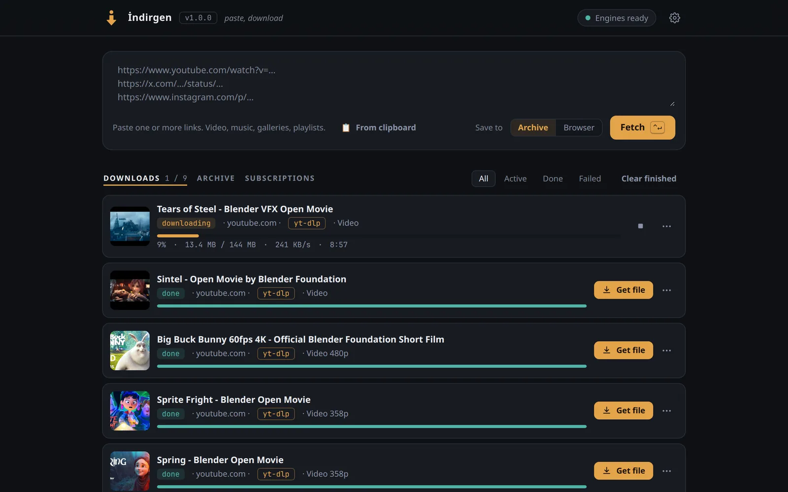

# İndirgen

> Yapıştır, indir. — Paste, download.

**Site:** [yfthcn.github.io/indirgen](https://yfthcn.github.io/indirgen/) ([Türkçe](https://yfthcn.github.io/indirgen/?lang=tr))

<picture>
  <source media="(prefers-color-scheme: light)" srcset="site/assets/shots/downloads-en-light.webp">
  
</picture>

A self-hosted media downloader for one person: **yt-dlp** and **gallery-dl** behind one web interface, with their engines (yt-dlp, gallery-dl, ffmpeg, Deno) installed and kept on the latest release automatically. One Go binary, no dependencies, no account, no telemetry.

Use it from the browser on the computer it runs on, from your phone over Wi-Fi or a VPN, from a Telegram bot, an iPhone Shortcut or the browser extension.

## Features

- **Videos, music, galleries, playlists** from the sites yt-dlp and gallery-dl support. İndirgen picks the engine (or both, and keeps the better result); you can force the other one.
- **Live queue**: progress, speed and ETA; global and per-site parallelism; retries; survives restarts.
- **Archive**: browse, search, play and delete what you downloaded; "already downloaded" is recognised before downloading again.
- **Subscriptions**: channels, playlists, profiles and galleries checked on a schedule; only new items are fetched.
- **Instagram profiles**: pick sections (posts, reels, stories, highlights…) or browse and hand-pick posts.
- **Telegram bot**: send it a link from any app; it reports back and sends files up to 50 MB.
- **iPhone Shortcut** "Send to İndirgen", and "Download to phone", which saves the finished video to Photos.
- **Browser extension** (Chrome/Edge, Firefox): toolbar button, context menu, Alt+Shift+I.
- **Logins**: uses your Firefox logins directly, or an imported `cookies.txt`.
- **Speed limit, night hours, low-disk guard, desktop notifications, backup/restore.**

## Install

### Linux (recommended for a desktop or laptop)

```sh
curl -fsSL https://github.com/yfthcn/indirgen/releases/latest/download/install.sh | sh
```

The script downloads the binary for your machine, verifies it against the release's `SHA256SUMS` and runs `indirgen install`, which:

- copies the program to `~/.local/bin/indirgen` (the download goes through `~/.cache`, not `/tmp`),
- writes and starts a systemd **user** service (it starts at boot, without a login, through `loginctl enable-linger`; pass `-no-linger` to skip that: `… | sh -s -- -no-linger`),
- adds an "İndirgen" entry to the application menu.

No `sudo`, nothing outside your home folder. Then open **http://127.0.0.1:8899**.

`indirgen status` shows whether it runs and where everything is. `indirgen help` lists all commands.

### Docker (recommended for a server)

```sh
mkdir indirgen && cd indirgen
curl -fsSLO https://raw.githubusercontent.com/yfthcn/indirgen/main/compose.yaml
curl -fsSL  https://raw.githubusercontent.com/yfthcn/indirgen/main/.env.example -o .env
mkdir -p data downloads          # as your own user, before the first start
docker compose up -d
docker compose exec indirgen indirgen token
```

Open `http://127.0.0.1:8899` on the server and enter the token. The image (`ghcr.io/yfthcn/indirgen`, amd64 and arm64) holds only İndirgen; the engines download into `./data` and update themselves there.

- Settings that differ per machine go into `.env` (user id, bind address, port, folders, time zone).
- Larger changes, such as publishing only on a VPN address, go into `compose.override.yaml`. Compose merges it automatically and git ignores it. See `compose.override.example.yaml`.
- Docker's published ports bypass `ufw`: widen `INDIRGEN_BIND` deliberately.
- Inside the container İndirgen does not know the server's name: open it by IP address, or list the names you use in `INDIRGEN_ALLOWED_HOSTS`.
- On arm64 (Raspberry Pi) the image has no gallery-dl, because gallery-dl publishes a standalone binary only for amd64. Videos work; galleries and Instagram need amd64 or a native install with `pipx install gallery-dl`.
- To build the image yourself from a clone, uncomment `build: .` in your `compose.override.yaml`.

### Windows and macOS (Docker Desktop)

İndirgen runs natively on Linux only. On Windows and macOS it runs in [Docker Desktop](https://www.docker.com/products/docker-desktop/), with the same image as on a server.

> **Experimental:** this setup has not been tested on Windows or macOS.

Windows (PowerShell):

```powershell
New-Item -ItemType Directory -Force indirgen | Out-Null; Set-Location indirgen
curl.exe -fsSLO https://raw.githubusercontent.com/yfthcn/indirgen/main/compose.yaml
curl.exe -fsSLO https://raw.githubusercontent.com/yfthcn/indirgen/main/.env.example
Copy-Item .env.example .env
New-Item -ItemType Directory -Force data, downloads | Out-Null
docker compose up -d
docker compose exec indirgen indirgen token
```

macOS (zsh):

```sh
mkdir indirgen && cd indirgen
curl -fsSLO https://raw.githubusercontent.com/yfthcn/indirgen/main/compose.yaml
curl -fsSLO https://raw.githubusercontent.com/yfthcn/indirgen/main/.env.example
cp .env.example .env
mkdir -p data downloads
docker compose up -d
docker compose exec indirgen indirgen token
```

Then open `http://127.0.0.1:8899` and enter the token. Set `TZ` in `.env` (for example `TZ=Europe/Istanbul`) so the night hours follow your clock.

- **Start with the computer:** turn on "Start Docker Desktop when you sign in" in Docker Desktop's settings. The container restarts on its own once Docker Desktop runs.
- **Logins:** the container cannot read your Firefox, so "Use the logins in Firefox" is not available. Import a `cookies.txt` instead (Settings → Cookies).
- **From the phone:** set `INDIRGEN_BIND=0.0.0.0` in `.env`, run `docker compose up -d` again, and allow incoming connections to port 8899 in the system firewall (Windows Defender Firewall; on macOS, System Settings → Network → Firewall). Then open `http://<computer's IP>:8899` on the phone and sign in with the token. Use it on your home network or over a VPN, never directly on the internet.
- **Apple Silicon:** the arm64 image has no gallery-dl (gallery-dl publishes a standalone binary only for amd64), so galleries and Instagram do not work with it. To use the amd64 image through Rosetta, turn on "Use Rosetta for x86_64/amd64 emulation on Apple Silicon" in Docker Desktop and create `compose.override.yaml` next to `compose.yaml`:

  ```yaml
  services:
    indirgen:
      platform: linux/amd64
  ```

  Then `docker compose pull && docker compose up -d`.

### From source

```sh
git clone https://github.com/yfthcn/indirgen && cd indirgen
go build -o indirgen .       # Go 1.26 or newer
./indirgen install           # or just ./indirgen to run it in the terminal
```

## Uninstall

```sh
indirgen uninstall           # removes the program, the service and the menu entry
indirgen uninstall -purge    # also deletes the settings, engines, queue and cookies
```

Downloaded files are never deleted. Docker: `docker compose down` (and delete `./data` if you like).

## Update

Settings → About shows new releases. **Update** downloads the new binary, checks it against `SHA256SUMS`, test-runs it, swaps it in and restarts; the previous one is kept as `indirgen.old`. From a terminal: `indirgen update`. Docker: `docker compose pull && docker compose up -d`.

The engines update on their own, every 6 hours. Each one is checksum-verified and test-run before it replaces the old one, and the previous version stays for one-click rollback. ffmpeg's daily rebuilds of the same version are skipped (at most one a month).

**YouTube stopped working?** Settings → Engines → yt-dlp → **Nightly**. Fixes for site changes reach yt-dlp's nightly builds days before a stable release. Switch back to **Stable** later.

## Where things are

| What | Native install | Docker |
|---|---|---|
| Program | `~/.local/bin/indirgen` | the image |
| Settings, engines, queue, cookies | `~/.local/share/indirgen/` | `./data` |
| Service | `~/.config/systemd/user/indirgen.service` | `compose.yaml` |
| Menu entry | `~/.local/share/applications/indirgen.desktop` | – |
| Downloads | `~/Downloads/İndirgen` (Settings → Archive folder) | `./downloads` |
| Logs | `journalctl --user -u indirgen -f` | `docker compose logs -f` |

**Backup**: Settings → Backup downloads one ZIP with the settings, subscriptions, cookies, the Telegram pairing and the "already downloaded" records. Restoring it keeps the address and archive folder of the installation it goes into, so a laptop backup moves into Docker as is. After reinstalling a computer: install with the one-liner, then restore the ZIP.

## Access and security

- **This computer only** by default (`127.0.0.1`), no password.
- **Network access** (Settings → Phone and extension) opens it to the LAN/VPN for the phone. Other devices then need the **access token**: `indirgen token` prints it; the browser remembers a login for 90 days. Requests from this computer itself never need it.
- İndirgen only answers to IP addresses, `localhost` and this computer's own name (`name`, `name.local`, `name.lan`). This blocks DNS-rebinding attacks from web pages. If you open it through another name (a reverse proxy, VPN DNS, or any name with Docker), add it to `allowed_hosts` in `config.json` or to `INDIRGEN_ALLOWED_HOSTS`.
- Run **one** İndirgen per Telegram bot: a bot can be read by one program at a time.
- Your data never belongs in this repository. Settings, tokens, cookies and history live in the data folder, outside it, and `.gitignore` blocks the usual copies.

Do not expose İndirgen to the internet directly. Use a VPN (WireGuard, Tailscale) or a reverse proxy with its own authentication.

## Using it

### Telegram

Settings → Telegram: create a bot with @BotFather (`/newbot`), paste its token, then pair your chat with the one-time link. Share links to the bot; it answers when they are done and sends files up to 50 MB (the Bot API limit).

- `/durum`: what is in the queue.
- `/gecici <link>`: downloads to a temporary folder instead of the archive.
- `/gece <link>`: waits for the night hours.
- `/yeniden <link>`: downloads again even if the item is already in the archive.

Results of Shortcut, extension and subscription jobs are reported too. Long polling: nothing needs to be reachable from the internet; unpaired chats get no answer.

### iPhone Shortcut and the browser extension

Turn on Settings → Phone and extension → Network access; the step-by-step Shortcut guide with your address and token is right there. For the extension, download `indirgen-extension-chrome-*.zip` or `…-firefox-*.zip` from the release and load it (Chrome: `chrome://extensions` → Developer mode → Load unpacked; Firefox: `about:debugging` → Load Temporary Add-on).

`POST /api/add` queues every link in the body (JSON `{"url": "…", "mode": "library|temp", "night": true}` or plain text); `?wait=1` answers with the downloaded file. Other devices send `Authorization: Bearer <token>`.

### Logins (Instagram, X, members-only videos)

- **Firefox** (native install): Settings → Cookies → "Use the logins in Firefox". İndirgen finds the profile itself (also the Snap and Flatpak Firefox). Being logged in there is enough; nothing needs re-exporting. Each download gets only the cookies of its own site, and YouTube and Google cookies are never used, so that account stays safe even when a link redirects there.
- **cookies.txt**: paste or upload a browser export (Netscape `cookies.txt` or Cookie-Editor JSON). İndirgen lists the sites in it and stores only the ones you tick, one file per site, mode 0600. An imported file wins over Firefox.

### Subscriptions, profiles, archive

- **Subscribe** on a channel, playlist, profile or gallery card. Each check looks at the newest N items and downloads only what is new. For YouTube, subscribe to `…/@channel/videos`.
- **Instagram profiles**: pick sections, or browse a section 48 posts at a time and pick posts. "Only new" skips what you already have. Settings → Bot protection paces requests.
- **Archive** tab: folders by site and channel (or one folder: Settings → Archive folder), search, play in the browser, ZIP a folder, delete.

## Configuration

`config.json` in the data folder; every key has a default, and most are set from the UI.

| Key | Default | |
|---|---|---|
| `listen` | `127.0.0.1:8899` | Settings → Phone and extension switches LAN access |
| `library` | `~/Downloads/İndirgen` | Settings → Archive folder |
| `layout` | `site` | `site`: `Site/Channel/date - title [id].ext`; `flat`: one folder |
| `auth` | `auto` | `auto`: token for other devices only; `always`; `never` |
| `allowed_hosts` | `[]` | extra host names İndirgen answers to |
| `concurrency` / `per_host` | `3` / `2` | parallel downloads |
| `rate_limit_mb` | `0` | total MB/s, 0 = unlimited |
| `night_start` / `night_end` | `01:00` / `07:00` | window for "download at night" |
| `min_free_mb` | `1024` | below this, new downloads wait |
| `temp_retention_hours` | `24` | temporary downloads are deleted after this |
| `browser_cookies` | `""` | `firefox`: use Firefox's logins |
| `ytdlp_channel` | `stable` | `nightly` for yt-dlp's nightly builds |
| `sub_langs` | `tr.*,en.*` | subtitle languages |
| `auto_update` / `update_interval_hours` | `true` / `6` | engine updates |
| `update_check` | `on` | look for new İndirgen releases |

Command-line flags `-listen`, `-library` and `-data` apply to that run only. `GITHUB_TOKEN` raises the GitHub API limit for update checks. `NO_COLOR` turns off colored terminal output.

## Development

```sh
go vet ./... && go test -race ./...
./build.sh                         # binaries for linux/amd64, linux/arm64 + SHA256SUMS
./extension/build.sh               # extension zips
```

Release: bump `version` in `main.go`, add `## x.y.z · date` to `CHANGELOG.md`, commit, `git tag vx.y.z && git push origin vx.y.z`. GitHub Actions builds the binaries with the newest stable Go, publishes them with `SHA256SUMS`, `install.sh` and the extension, and pushes the multi-arch image to ghcr.io. After the first release, make the ghcr.io package public (Package settings → Change visibility); new packages start private and `docker compose pull` fails for everyone else until then.

## Platforms

- **Native install:** Linux only (amd64, arm64), as a systemd user service.
- **Windows and macOS:** Docker Desktop, see [Windows and macOS (Docker Desktop)](#windows-and-macos-docker-desktop). Experimental, not tested there yet.

gallery-dl publishes a standalone binary only for linux/amd64. On linux/arm64 İndirgen uses a `gallery-dl` on PATH (`pipx install gallery-dl`); the arm64 Docker image has none.

## Legal

MIT licensed (see `LICENSE`). İndirgen is a tool for downloading media you are allowed to download. Respect copyright and the terms of the sites you use it with.

## Türkçe özet

İndirgen, tek kişilik, kendi bilgisayarında çalışan bir medya indiricidir: yt-dlp ve gallery-dl'i tek web arayüzünde toplar, motorlarını (yt-dlp, gallery-dl, ffmpeg, Deno) kendisi kurar ve en son kararlı sürümde tutar. Bağımlılığı olmayan tek bir Go programı; hesap ve telemetri yok. Tarayıcıdan, telefondan, Telegram botundan, iPhone Kestirmesi'nden ya da tarayıcı eklentisinden bağlantı gönderebilirsin.

**Kurulum (Linux):** `curl -fsSL https://github.com/yfthcn/indirgen/releases/latest/download/install.sh | sh` sonra **http://127.0.0.1:8899**. `sudo` gerekmez; program `~/.local/bin`'e, kullanıcı servisi systemd'ye kurulur.

**Docker:** `compose.yaml` ile `.env.example`'ı indir (`.env` olarak kaydet), `mkdir -p data downloads`, `docker compose up -d`; token için `docker compose exec indirgen indirgen token`.

**Windows ve macOS:** yerel kurulum yok, Docker Desktop ile çalışır (PowerShell ve zsh komutları: "Windows and macOS (Docker Desktop)"). Firefox oturumları konteynerde kullanılamaz, `cookies.txt` içe aktar. Telefondan erişim için `.env`'de `INDIRGEN_BIND=0.0.0.0` yap ve güvenlik duvarında 8899 numaralı porta izin ver. Docker Desktop'ta "oturum açılınca başlat" açık olmalı. Apple Silicon'da arm64 imajında gallery-dl yok; galeriler için `compose.override.yaml`'a `platform: linux/amd64` ekle (Rosetta). Bu kurulum Windows ve macOS'ta test edilmedi (deneysel).

**Kaldırma:** `indirgen uninstall` (ayarlar da silinsin dersen `-purge`). İndirilen dosyalara hiçbir zaman dokunulmaz.

**Güvenlik:** Varsayılan olarak yalnızca bu bilgisayardan erişilir. Telefon için ağ erişimini Ayarlar → Telefon ve eklenti'den aç; diğer cihazlar token ister. Yerel ağda ya da VPN (WireGuard, Tailscale) üzerinden kullan, **doğrudan internete açma**.
